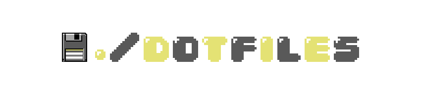

    

# Dotfiles

Configurações pessoais organizadas por sistema operacional, mantidas dentro da pasta `system/`:

- **`system/arch`** — setup completo do Arch Linux com Niri e Noctalia Shell
- **`system/nixos`** — configuração declarativa do NixOS, também com Noctalia Shell, organizada em módulos

Cada subpasta contém seus próprios dotfiles, scripts de instalação e documentação específica.
